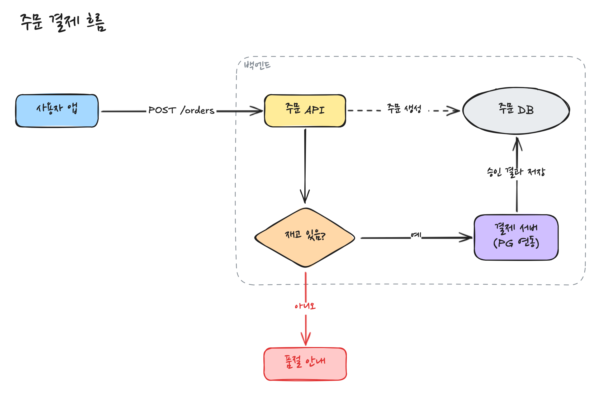
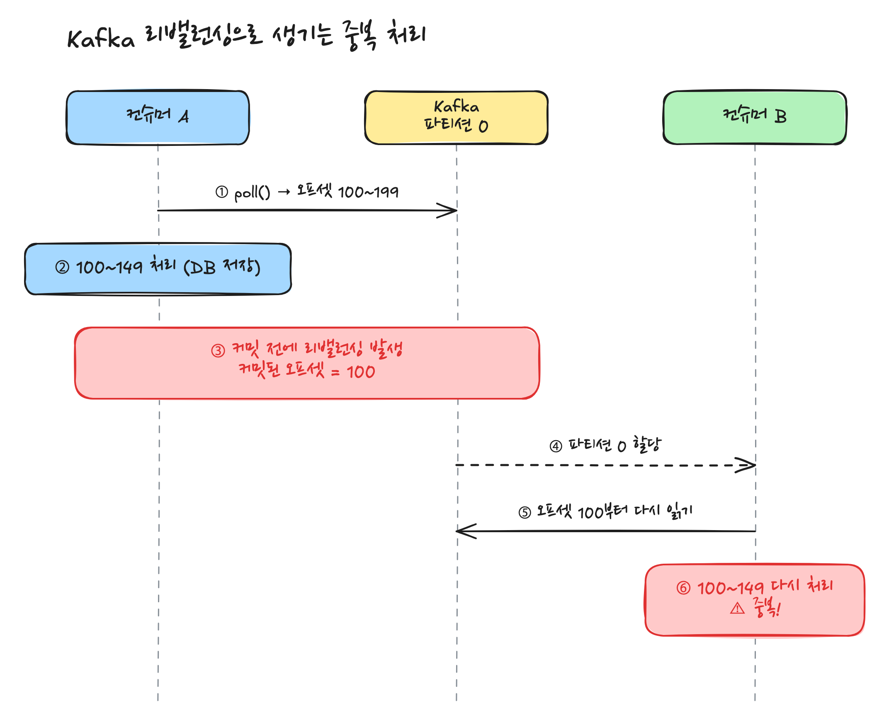
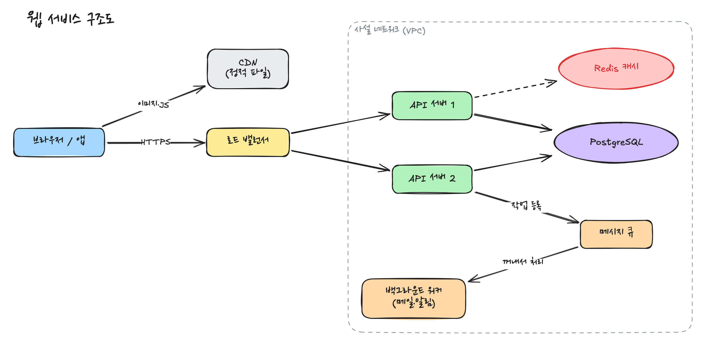
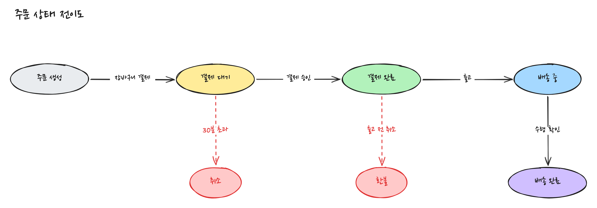
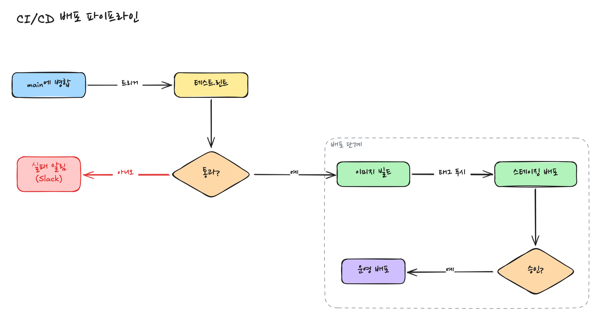
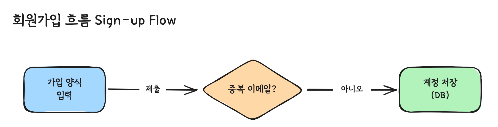
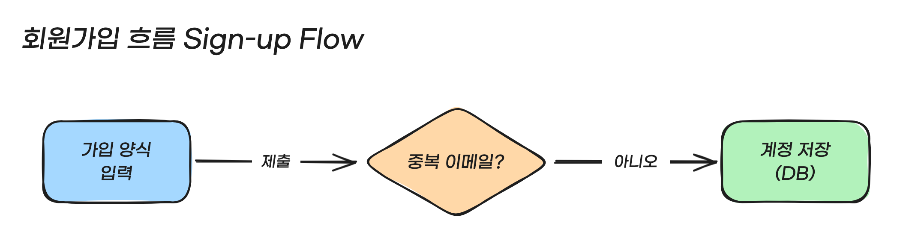
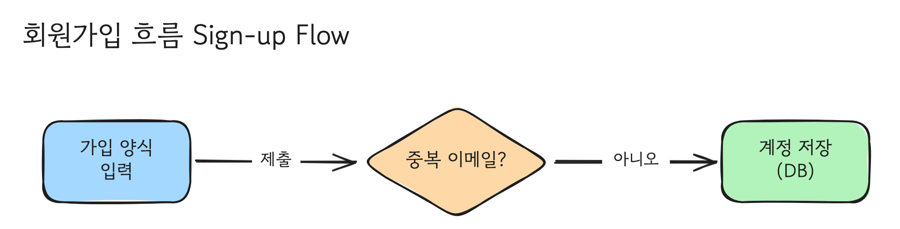
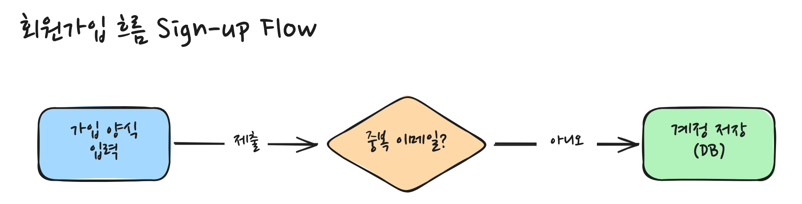

# excalidraw-for-agent

Claude Code나 Codex에게 **"그림으로 설명해줘"** 라고 말하면, 손으로 그린 느낌의 다이어그램을 그려 주는 도구입니다. 그림은 에이전트가 그리고, 사람은 보기만 하면 됩니다.

## 이런 그림을 그려 줍니다

| 흐름도 | 시퀀스 다이어그램 |
|---|---|
|  |  |
| **구조도** | **상태 전이도** |
|  |  |
| **파이프라인** | |
|  | |

## 설치

다른 프로그램을 미리 깔 필요가 없습니다. macOS, Windows, Linux에서 쓸 수 있습니다.

### 방법 1. 에이전트에게 맡기기 (추천)

Claude Code나 Codex 대화창에 아래 문장을 그대로 붙여 넣으세요.

```text
https://github.com/gunflake/excalidraw-for-agent 를 설치해줘.
README의 "에이전트용 설치 절차"를 순서대로 따르고, 끝나면 확인용 그림을 하나 그려서 보여줘.
```

- 중간에 스킬을 어디에 설치할지 물으면 **"1) 모든 프로젝트에서 쓰기"** 를 고르세요. 스킬은 에이전트가 그림 그리는 법을 적어 둔 안내서입니다.
- 설치가 끝나면 에이전트가 확인용 그림을 보여 줍니다.

### 방법 2. 직접 설치

macOS / Linux는 **터미널**에, Windows는 **PowerShell**에 한 줄을 붙여 넣고 실행하세요. 질문이 나오면 엔터만 누르면 됩니다.

macOS / Linux:

```bash
curl -fsSL https://raw.githubusercontent.com/gunflake/excalidraw-for-agent/main/install.sh | bash
```

Windows:

```powershell
irm https://raw.githubusercontent.com/gunflake/excalidraw-for-agent/main/install.ps1 -OutFile "$env:TEMP\excali-install.ps1"; powershell -ExecutionPolicy Bypass -File "$env:TEMP\excali-install.ps1"
```

## 사용법

설치한 뒤 에이전트에서 **새 대화**를 열고 이렇게 말하세요.

- "회원가입 흐름을 그림으로 그려줘"
- "로그인할 때 브라우저·서버·DB가 주고받는 걸 시퀀스 다이어그램으로 그려줘"
- "우리 서비스 서버 구성을 구조도로 그려줘"
- "주문 상태가 어떻게 바뀌는지 그림으로 보여줘"

그림은 대화창에 이미지로 오고, 브라우저에도 그림 보기 화면이 열립니다.

- **고치고 싶을 때:** 에이전트에게 "이 상자 이름 바꿔줘", "화살표 방향 반대로" 처럼 말하세요.
- **그림 보기 화면:** 왼쪽 목록에서 지금까지 연 그림을 고르고, 오른쪽 위에서 글꼴을 바꿀 수 있습니다. 다른 곳에 있는 `.excalidraw` 파일은 화면에 끌어다 놓으면 열립니다.
- **그림 파일 위치:** 내 홈 폴더의 `diagrams` 폴더에 PNG와 `.excalidraw` 파일로 저장됩니다. `.excalidraw` 파일은 [excalidraw.com](https://excalidraw.com)에 끌어다 놓으면 직접 고칠 수도 있습니다.

## 글꼴을 골라 볼 수 있습니다

그림 보기 화면 오른쪽 위에서 한글이 잘 읽히는 글꼴 네 가지 중 하나를 고를 수 있습니다. 고른 글꼴은 다음에 열 때도 그대로입니다.

| 강원교육모두 Bold (기본) |
|---|
|  |
| **Slant Sans** |
|  |
| **Gowun Dodum (고운돋움)** |
|  |
| **나눔손글씨 펜** |
|  |

## 더 알아보기

아래는 자세한 설명입니다. 필요할 때 펼쳐 보세요.

<details>
<summary><b>에이전트용 설치 절차</b></summary>

> 이 절은 설치를 맡은 에이전트를 위한 것입니다. 위에서부터 순서대로 실행하고, 실패한 단계는 원인을 고친 뒤 다시 실행하세요. 이미 설치되어 있어도 그대로 다시 실행하면 최신 배포본으로 바뀝니다.

1. **스킬 설치 범위 묻기.** 에이전트가 실행하면 설치 스크립트가 입력을 받을 수 없어 스스로 묻지 못하므로, 에이전트가 사용자에게 아래 선택지를 그대로 묻습니다.
   > excali 스킬을 어디에 설치할까요? 스킬이 있으면 다이어그램을 요청할 때 에이전트가 이 스킬을 참고해 그립니다.
   > 1) 모든 프로젝트에서 쓰기 (추천)
   > 2) 특정 프로젝트 폴더에서만 쓰기
   > 3) 설치하지 않기

   2를 고르면 어느 폴더인지 묻습니다(기본: 지금 작업 중인 폴더). 3을 고르면 바로 따르지 말고 한 번 더 묻습니다.
   > 스킬이 없으면 에이전트가 excali 쓰는 법을 모릅니다. 그림을 부탁할 때마다 사용법 문서를 읽으라고 직접 알려 줘야 하고, "그림으로 설명해줘"라고만 하면 excali 대신 Mermaid나 글로 답합니다. 그래도 설치하지 않을까요?
   > 1) 모든 프로젝트에서 쓰기 (추천)
   > 2) 그래도 설치하지 않기
2. **설치.** 답에 따라 옵션을 붙여 실행합니다.

   | 답 | macOS / Linux | Windows |
   |---|---|---|
   | 모든 프로젝트 | `--skill global` | `-Skill global` |
   | 특정 프로젝트 | `--skill project --project-dir <폴더>` | `-Skill project -ProjectDir <폴더>` |
   | 설치하지 않기 | `--no-skill` | `-NoSkill` |

   아래는 모든 프로젝트로 설치하는 예입니다.

   macOS / Linux:
   ```bash
   curl -fsSL https://raw.githubusercontent.com/gunflake/excalidraw-for-agent/main/install.sh | bash -s -- --skill global
   ```
   Windows (PowerShell):
   ```powershell
   irm https://raw.githubusercontent.com/gunflake/excalidraw-for-agent/main/install.ps1 -OutFile "$env:TEMP\excali-install.ps1"; powershell -ExecutionPolicy Bypass -File "$env:TEMP\excali-install.ps1" -Skill global
   ```
   설치 스크립트가 하는 일은 아래 "설치 스크립트가 하는 일"에 있습니다. Chrome이나 Edge가 없으면 PNG용 Chromium(약 100MB)을 받으니, 오래 걸리면 사용자에게 그렇다고 알립니다.
3. **동작 확인.** 지금 셸에는 PATH 변경이 아직 반영되지 않았으므로 전체 경로로 실행합니다.

   macOS / Linux:
   ```bash
   ~/.local/bin/excali new install-check && ~/.local/bin/excali build install-check
   ```
   Windows (PowerShell):
   ```powershell
   & "$HOME\.excali\bin\excali.cmd" new install-check; & "$HOME\.excali\bin\excali.cmd" build install-check
   ```
   `~/diagrams/install-check.png`가 생기면 그 PNG를 사용자에게 보여 주고, 같은 명령에 `-d ~/diagrams/install-check.excalidraw`(Windows는 `-d "$HOME\diagrams\install-check.excalidraw"`)를 붙여 뷰어를 엽니다.
4. **보고.** 확인용 PNG 경로를 알려 줍니다. 스킬을 설치했으면 설치된 스킬 경로도 알려 주고, 스킬은 새 세션부터 확실히 잡히니 새 세션에서 그림을 요청하라고 안내합니다. 스킬 없이 설치했으면 그림을 부탁할 때 "`~/.excali/app/skill/excalidraw-diagram/SKILL.md`를 읽고 그대로 그려줘"라고 말하면 된다고 알려 줍니다. 새 터미널부터는 `excali`만 입력해도 실행된다고 알려 줍니다.

</details>

<details>
<summary><b>설치 스크립트가 하는 일 · 지우는 법</b></summary>

설치 스크립트는 운영체제에 맞는 배포본(Node.js 실행 파일이 들어 있는 약 60MB 압축 파일)을 받아 씁니다. 이미 깔린 Node.js가 있어도 쓰지도 건드리지도 않습니다. macOS와 Windows는 관리자 암호가 필요 없습니다. Linux는 PNG 출력용 Chromium이 쓰는 시스템 라이브러리가 없으면 한 번 관리자 권한으로 깔아야 하고, 이때 설치 스크립트가 실행할 명령을 알려 줍니다.

1. 운영체제·CPU에 맞는 배포본을 [GitHub Releases](https://github.com/gunflake/excalidraw-for-agent/releases)에서 받아 `~/.excali/app`에 풉니다. 안에 Node.js 실행 파일(`runtime/`)과 빌드된 뷰어가 들어 있습니다.
2. `excali` 명령을 만듭니다.
   - macOS / Linux: `~/.local/bin/excali`. PATH에 없으면 셸 설정(`~/.zshrc` 등)에 한 줄 추가합니다.
   - Windows: `~/.excali/bin/excali.cmd`. 사용자 PATH에 추가합니다.
3. `excalidraw-diagram` 스킬을 넣습니다. `~/.claude`가 있으면 Claude Code용, `~/.codex`가 있으면 Codex용으로 넣습니다.

   | 범위 | Claude Code | Codex | 방식 |
   |---|---|---|---|
   | 모든 프로젝트 | `~/.claude/skills` | `~/.agents/skills` | 링크(Windows는 디렉터리 정션). 업그레이드하면 스킬도 새 버전이 됩니다. |
   | 특정 프로젝트 | `<폴더>/.claude/skills` | `<폴더>/.agents/skills` | 복사. 저장소에 함께 올려 팀원과 나눌 수 있고, 업그레이드하려면 설치를 다시 실행합니다. |
4. PNG용 브라우저를 확인합니다. Google Chrome이나 Microsoft Edge가 있으면 그대로 쓰고, 없으면 Chromium 헤드리스 셸(약 100MB)을 받습니다. 나중에 `excali setup-browser`로 다시 할 수도 있습니다.

질문 없이 설치하려면 위 "에이전트용 설치 절차"의 표에 있는 옵션을 붙이세요. macOS / Linux는 `bash -s -- --skill global`처럼 `-s --` 뒤에 붙입니다.

지우려면 `~/.excali` 폴더, `excali` 명령(macOS / Linux는 `~/.local/bin/excali`), 스킬 폴더(위 표의 위치)를 삭제하고, 셸 설정이나 사용자 PATH에 추가된 줄을 지우면 됩니다.

</details>

<details>
<summary><b>excali 명령 목록</b></summary>

| 명령 | 설명 |
|---|---|
| `excali [파일 또는 폴더]` | 뷰어로 엽니다. 기본은 현재 폴더입니다. |
| `excali -d [파일 또는 폴더]` | 뷰어를 백그라운드로 띄웁니다. |
| `excali png <파일.excalidraw> [출력.png]` | 뷰어와 같은 폰트로 PNG를 만듭니다. |
| `excali new <이름>` | `~/diagrams/src/<이름>.mjs` 그림 스크립트 틀을 만듭니다. |
| `excali build <이름>` | 스크립트를 실행하고 점검한 뒤 `.excalidraw`, `.png`를 만듭니다. |
| `excali stop` | 백그라운드 뷰어를 모두 끕니다. |
| `excali setup-browser` | Chrome이나 Edge가 없을 때 PNG용 Chromium(약 100MB)을 받습니다. 있으면 아무것도 하지 않습니다. |

같은 폴더를 보는 뷰어가 이미 떠 있으면 새로 띄우지 않고, 열린 화면이 해당 파일로 넘어갑니다. 그림 폴더는 `EXCALI_HOME` 환경 변수로 바꿀 수 있습니다(기본 `~/diagrams`).

에이전트는 스킬에 따라 아래 순서로 일합니다.

1. `excali new <이름>` 으로 `~/diagrams/src/<이름>.mjs` 틀 만들기
2. Scene API로 스크립트 작성
3. `excali build <이름>` 으로 `~/diagrams/<이름>.excalidraw`, `.png` 만들기
4. 점검 경고와 PNG를 보고 고치기를 반복
5. 대화창에 PNG를 보내고 `excali -d` 로 뷰어 열기

</details>

<details>
<summary><b>뷰어 자세히 (파일 목록 · 글꼴 · 끌어다 놓기)</b></summary>

왼쪽 "파일 목록"에는 뷰어로 열었던 그림이 처음 연 순서대로 쌓여, 가장 최근에 추가된 그림이 맨 위에 옵니다(2개 이상일 때, 10개까지). 이미 있는 그림은 다시 열어도 자리가 바뀌지 않습니다. 다른 폴더에서 연 그림도 누르면 지금 뷰어에서 바로 열립니다. 목록 왼쪽 위 버튼으로 접으면 펼치기 버튼만 있는 좁은 띠가 남습니다. 띠에 마우스를 올리면 목록이 잠깐 펼쳐지고, 버튼을 누르면 다시 펼친 채로 고정됩니다. 기록은 `~/.excali/recent.json`에 20개까지 남고, 지워진 파일은 목록에서 빠집니다. PNG를 만들 때는 기록하지 않습니다. 다른 폴더의 그림은 파일이 바뀌어도 화면이 저절로 다시 그려지지 않으니 새로고침하세요.

다른 곳에 있는 `.excalidraw` 파일은 뷰어 화면에 끌어다 놓으면 보고 있는 폴더에 저장한 뒤 바로 엽니다. 같은 이름이 있으면 덮어쓰지 않고 `이름-2.excalidraw`처럼 번호를 붙여 저장합니다.

뷰어는 기본으로 강원교육모두 Bold로 글자를 보여 줍니다. 오른쪽 위 메뉴에서 Slant Sans, Gowun Dodum(고운돋움), 나눔손글씨 펜으로 바꿀 수 있습니다. 고른 글꼴과 목록 접힘 상태는 `~/.excali/settings.json`에 저장되어, 뷰어 포트가 달라져도 그대로 유지됩니다. 뷰어 화면에만 적용되고, `.excalidraw` 파일과 `excali png`·`excali build`로 만든 PNG는 손글씨 그대로입니다. PNG에서 한글은 나눔손글씨 펜으로 보입니다. Excalidraw 기본 손글씨 폰트(Excalifont)에 한글 글리프가 없어서, 한글 범위만 나눔손글씨로 바꿔 끼웁니다.

뷰어는 보기 전용입니다. 고치고 싶으면 에이전트에게 말하거나, `.excalidraw` 파일을 [excalidraw.com](https://excalidraw.com)에 끌어다 놓고 편집하세요.

</details>

<details>
<summary><b>Scene API (그림 스크립트 작성법)</b></summary>

```js
import { Scene } from "excalidraw-for-agent/scene";

const scene = new Scene();
scene.text({ x: 60, y: 20, text: "주문 결제 흐름", size: 30 });

const app = scene.box({ cx: 130, cy: 200, label: "사용자 앱", color: "blue" });
const api = scene.box({ cx: 600, cy: 200, label: "주문 API", color: "yellow" });
const check = scene.box({ cx: 600, cy: 440, label: "재고 있음?", color: "orange", shape: "diamond" });

scene.arrow(app, api, { label: "POST /orders" });
scene.arrow(api, check, { fromSide: "bottom", toSide: "top" });
scene.group([api, check], { label: "백엔드" });

scene.save("/path/to/order-flow.excalidraw");
```

| 메서드 | 설명 |
|---|---|
| `text({ x, y, text, size, color, align })` | 자유 위치 글자 |
| `box({ cx, cy \| x, y, label, color, shape, w, h, dashed })` | 라벨이 든 사각형·타원·마름모. 크기를 빼면 라벨에 맞춥니다. |
| `arrow(from, to, { label, fromSide, toSide, dashed, color, head, tail })` | 두 도형에 붙는 화살표 |
| `path(points, { arrow, dashed, color, width })` | 도형에 안 붙는 꺾은선 |
| `group(shapes, { label, padding })` | 여러 도형을 감싸는 점선 영역 |
| `sequence({ participants, steps, gap, rowHeight })` | 시퀀스 다이어그램 |
| `lint()` | 라벨이 화살표보다 긴 곳, 겹친 도형을 찾습니다. `save()`가 자동으로 부릅니다. |

색: `blue` `green` `yellow` `orange` `purple` `gray` `red` `white` `none`

맨 위 그림들의 스크립트는 [examples/](examples/)에 있습니다: [`order-flow.mjs`](examples/order-flow.mjs), [`kafka-rebalance.mjs`](examples/kafka-rebalance.mjs), [`web-architecture.mjs`](examples/web-architecture.mjs), [`order-state.mjs`](examples/order-state.mjs), [`deploy-pipeline.mjs`](examples/deploy-pipeline.mjs). `npm run example`로 `examples/out/`에 다시 만들 수 있습니다.

</details>

<details>
<summary><b>구성 · 동작 방식</b></summary>

| 구성 요소 | 하는 일 |
|---|---|
| `lib/scene.mjs` (Scene API) | 상자, 화살표, 묶음, 시퀀스 다이어그램을 좌표로 만들고 `.excalidraw`로 저장합니다. 라벨이 화살표보다 길거나 도형이 겹치면 경고합니다. |
| `excali` 명령 | 그림 스크립트 만들기·빌드, PNG 출력, 로컬 뷰어 실행을 맡습니다. |
| 로컬 뷰어 | 보기 전용 Excalidraw 화면입니다. 파일이 바뀌면 바로 다시 그리고, 새 그림이 생기면 그 그림으로 넘어갑니다. |
| `skill/excalidraw-diagram` | 에이전트가 언제, 어떻게 그릴지 정한 스킬입니다. |

- 뷰어는 `127.0.0.1`에만 열리는 작은 Node HTTP 서버(5177번부터 빈 포트)입니다. 폴더를 감시하다가 `.excalidraw`가 바뀌면 SSE로 화면에 알립니다.
- 화면은 `@excalidraw/excalidraw` 0.18을 보기 전용·젠 모드로 띄운 것입니다.
- PNG는 같은 화면을 헤드리스 Chromium(`playwright-core`)으로 열어 Excalidraw의 `exportToBlob`으로 뽑습니다. 그래서 뷰어와 PNG의 폰트가 같습니다.
- 배포본에는 Node.js 24 실행 파일이 들어 있어, `excali`와 에이전트가 쓴 그림 스크립트 모두 그 Node로 실행됩니다.

</details>

<details>
<summary><b>개발자용: 소스에서 설치 · 배포</b></summary>

저장소를 clone한 폴더에서 설치 스크립트를 실행하면 배포본 대신 그 소스를 빌드해 연결합니다. 이때는 Node.js 20 이상이 필요합니다.

```bash
git clone https://github.com/gunflake/excalidraw-for-agent.git ~/Projects/excalidraw-for-agent
```

```bash
~/Projects/excalidraw-for-agent/install.sh
```

Windows는 clone한 폴더의 `install.ps1`을 `powershell -ExecutionPolicy Bypass -File`로 실행합니다(`npm link`로 연결).

배포본은 `v` 태그(예: `v0.1.0`, `package.json`의 버전과 같아야 함)를 푸시하면 GitHub Actions가 `npm run package`로 6개 플랫폼용 압축 파일을 만들어 Releases에 올립니다.

</details>

<details>
<summary><b>라이선스</b></summary>

- 코드: MIT
- 배포본에 포함된 Node.js: [MIT 계열 라이선스](https://github.com/nodejs/node/blob/main/LICENSE) (`runtime/LICENSE`), Playwright: Apache-2.0
- `fonts/NanumPenScript-Regular.ttf`: NAVER 나눔손글씨 펜, [SIL Open Font License 1.1](fonts/OFL.txt)
- `fonts/GowunDodum-Regular.ttf`: 고운돋움, [SIL Open Font License 1.1](fonts/OFL-GowunDodum.txt)
- `fonts/SlantSans-Medium.otf`: G마켓 산스 Medium을 7.7도 기울여 이름을 바꾼 글꼴, [SIL Open Font License 1.1](fonts/OFL-SlantSans.txt)
- `fonts/GangwonEduModu-Bold.otf`: 강원교육모두체 Bold, 저작권 강원특별자치도교육청([www.gwe.go.kr](https://www.gwe.go.kr)). 무료로 쓰고 배포할 수 있으며 유료 판매는 금지됩니다. 원본 파일은 브라우저가 거부해서, CFF 글꼴 이름의 공백을 없애고 깨진 `kern` 표를 뺐습니다.

</details>
